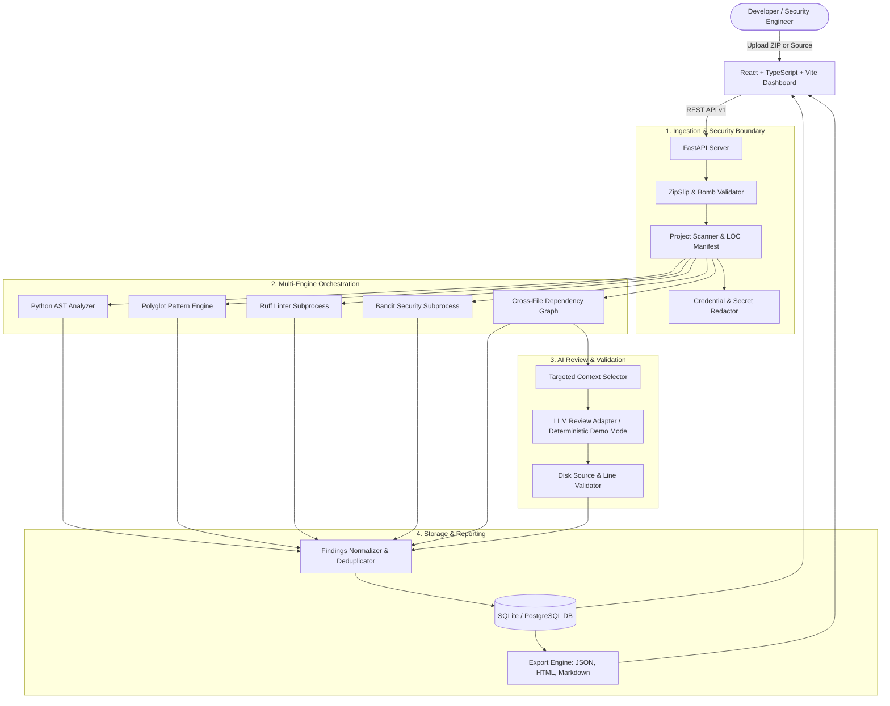

# CodeSentinel AI (DebugLens AI)
### Production-Style AI Code Review, Bug Detection, and Software Quality Analysis Platform

CodeSentinel AI allows developers to upload software archives (ZIP) or individual source files to identify syntax errors, security vulnerabilities, code quality issues, maintainability concerns, and subtle logical edge cases.

The platform combines deterministic static analysis tools (**Python AST**, **Ruff**, **Bandit**, **Polyglot Pattern Engine**) with **Cross-File Relationship Graphs** and an **AI Review Service** (with a deterministic offline Demo Mode).

---

## 🌟 Key Features

- **Multi-Engine Static Analysis:**
  - **Python AST Analyzer:** Built-in Python AST checks for syntax errors, mutable default arguments, bare `except:` clauses, dangerous `eval()`/`exec()`, insecure temporary files, and SQL injection risks.
  - **Polyglot Pattern Engine:** Detects DOM XSS (`innerHTML`), prototype pollution, template literal SQL injection, disabled SSL/TLS certificate verification, and insecure cryptography across JavaScript, TypeScript, Java, and HTML.
  - **Ruff & Bandit Adapters:** Executes Ruff and Bandit in isolated subprocesses with timeout and resource controls.
  - **Cross-File Dependency Graph:** Detects circular dependencies, broken cross-module imports, missing exported symbols, and untested modules.
- **AI-Assisted Code Review (With Offline Demo Mode):**
  - Sends only targeted, high-risk code context to the LLM.
  - Enforces structured JSON output validated against strict Pydantic schemas.
  - **Hallucination Guard:** Validates every file path and line number against actual project files on disk, rejecting fabricated references.
  - **Deterministic Demo Mode:** Operates completely offline with reproducible heuristic reviews when no external LLM API key is provided.
- **Enterprise Security & Safe Ingestion:**
  - **ZipSlip & Path Traversal Prevention:** Blocks path traversals (`..`), leading slashes, drive letters, and null bytes.
  - **Zip Bomb Defense:** Enforces a maximum decompression ratio of 50.0, a 200 MB uncompressed limit, and a 2,500 file limit.
  - **Zero Host Execution:** Uploaded project files, dependencies, and setup scripts are never executed directly on the host system.
  - **Credential Redaction:** Detects and masks API keys, AWS tokens, private keys, and secrets from reports and LLM payloads.
- **Interactive Developer Dashboard:**
  - Built with React, TypeScript, Vite, Tailwind CSS, Recharts, and Monaco Editor.
  - Live progress tracking with stage indicators and cancellation support.
  - Split-view Findings Explorer with syntax-highlighted source code and target line highlighting.
  - Full verification triage lifecycle (`UNREVIEWED`, `CONFIRMED`, `FALSE_POSITIVE`, `FIXED`, `ACCEPTED_RISK`) with audit history.
  - Export reports in **JSON**, standalone responsive **HTML**, and **Markdown**.

---

## 📐 System Architecture



---

## 🚀 Quick Start (Local Development)

### Prerequisites
- **Python 3.11+**
- **Node.js 18+** & **npm**

### 1. Backend Setup
```bash
cd backend

# Create and activate virtual environment (optional)
python -m venv venv
source venv/bin/activate  # On Windows: venv\Scripts\activate

# Install dependencies
pip install -r requirements.txt
pip install pytest pytest-asyncio

# Copy environment configuration
cp ../.env.example .env

# Start FastAPI development server
uvicorn app.main:app --host 127.0.0.1 --port 8000 --reload
```
The backend API and Swagger docs will be accessible at:
- **API Documentation:** `http://127.0.0.1:8000/docs`
- **Health Check:** `http://127.0.0.1:8000/health`

### 2. Frontend Setup
```bash
cd frontend

# Install npm dependencies
npm install

# Start Vite development server
npm run dev
```
The React dashboard will be running at:
- **Application URL:** `http://localhost:5173`

---

## 🐳 Docker Deployment

To launch the full stack in isolated containers:
```bash
docker-compose up --build
```
- Frontend: `http://localhost:5173`
- Backend API: `http://localhost:8000/docs`

---

## 🧪 Automated Testing

### Backend Unit & Integration Tests (19 Passed)
The backend test suite covers archive security, AST static analysis, cross-file import graph, LLM validation, and REST API endpoints:
```bash
cd backend
pytest -v
```

**Test Coverage Summary:**
- `test_ingestion_security.py`: ZipSlip directory traversal rejection, safe path validation, and zip bomb decompression limits.
- `test_scanner_manifest.py`: Language detection, lines of code calculation, secret scanner detection, and exclusion rules.
- `test_ast_and_patterns.py`: AST static rules (mutable default args, bare except, dynamic eval, division by zero, SQL injection) and JS/TS pattern checks.
- `test_cross_file.py`: Circular dependency graph detection and missing imported symbol verification across modules.
- `test_llm_service.py`: Hallucination guard (rejecting invalid lines or hallucinated files) and deterministic demo review mode.
- `test_api_endpoints.py`: End-to-end API tests covering analysis initiation, progress polling, finding verification status changes, and report export.

### Frontend Production Build & Linting
```bash
cd frontend
npm run build   # Validates TypeScript types and Vite bundling
npm run lint    # Runs oxlint static analysis
```

---

## 📂 Project Structure

```
CodeSentinel-AI/
├── frontend/
│   ├── src/
│   │   ├── components/      # Sidebar, SeverityBadge, StatusBadge, CodeViewer, StatCard
│   │   ├── pages/           # Dashboard, NewAnalysis, Progress, Results, Explorer, History, Settings, Docs
│   │   ├── services/        # Axios API client
│   │   ├── types/           # TypeScript data models and enums
│   │   ├── App.tsx          # Routes & layout
│   │   ├── main.tsx         # Root mounting
│   │   └── index.css        # Tailwind styling & dark navy theme
│   ├── package.json
│   ├── vite.config.ts
│   └── nginx.conf
├── backend/
│   ├── app/
│   │   ├── api/             # REST endpoints (analyses, findings, projects, reports, settings, stats)
│   │   ├── core/            # Configuration and security utilities (ZipSlip guard, secret redactor)
│   │   ├── db/              # SQLAlchemy engine and session dependencies
│   │   ├── models/          # Database entities (Project, AnalysisJob, Finding, Manifest)
│   │   ├── schemas/         # Pydantic v2 schemas
│   │   ├── services/        # Ingestion, scanner, cross-file, orchestrator, LLM review, reports
│   │   ├── analyzers/       # Python AST, Pattern Engine, Ruff, Bandit, Semgrep adapters
│   │   └── main.py          # FastAPI application entry point
│   ├── tests/               # Pytest automated test suite
│   ├── requirements.txt
│   └── Dockerfile
├── sample_projects/         # Intentionally vulnerable test fixtures
│   ├── vulnerable_python_app/
│   └── vulnerable_js_app/
├── docs/                    # Architecture documentation & diagrams
├── .env.example
├── .gitignore
├── docker-compose.yml
└── README.md
```

---

## 🔒 Security Guarantees & Boundaries

1. **Host Isolation:** Uploaded source code is never executed. No build commands, package installations, or arbitrary scripts are triggered on the server.
2. **Path Sanitization:** Archives are parsed with strict checks preventing path traversals or escaping from the designated temporary job workspace.
3. **Secret Protection:** High-entropy credentials are automatically masked from reports and external LLM queries.
4. **Distinction of Findings:** Confirmed static analyzer findings are clearly separated from AI hypotheses and user-verified statuses.
