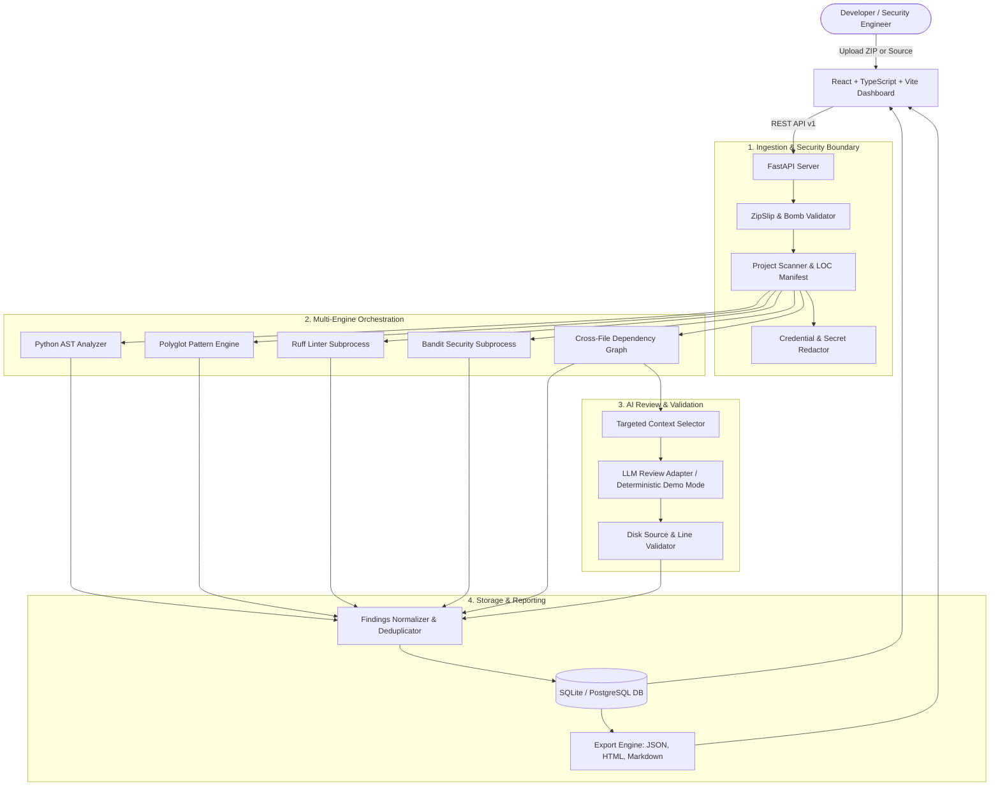

# CodeSentinel AI - Architecture & Technical Specification

## System Overview
CodeSentinel AI is a production-grade code review, static bug detection, and software quality analysis platform. It combines high-speed, deterministic static analyzers with deep cross-file dependency relationship mapping and structured AI-assisted code review.

---

## 1. File Ingestion & Security Hardening
- **Path Traversal Prevention:** Rejects entries with directory traversal (`..`), leading slashes, Windows drive letters (`C:`), or null bytes (`\0`).
- **Zip Bomb Defense:** Enforces a maximum decompression ratio of 50.0 and uncompressed total limits (200 MB, 2500 files, 5 MB single file).
- **Zero Arbitrary Execution:** Uploaded project files are never executed. Installation scripts (`setup.py`, `npm install`, shell scripts) are never executed automatically.
- **Secret Redaction:** High-entropy credentials (AWS keys, GitHub tokens, Bearer tokens, private keys) are detected and masked (`***REDACTED***`) before being processed by LLM services or included in exported reports.

---

## 2. Analysis Engines & Adapters
1. **Python AST Engine:** Standard library `ast.parse` checks syntax errors, mutable default arguments, bare except clauses, dynamic `eval`/`exec`, insecure temporary files, and unparameterized SQL queries.
2. **Polyglot Pattern Engine:** Regex and syntax pattern rules covering JavaScript, TypeScript, Java, and HTML (DOM XSS via `innerHTML`, prototype pollution, insecure TLS certificate verification, and template literal SQL injection).
3. **Ruff Adapter:** High-speed subprocess runner for Ruff static rules, Flake8-bugbear, and Pyflakes.
4. **Bandit Adapter:** Subprocess runner executing Bandit security AST checks with CWE classification.
5. **Cross-File Analyzer:** Extracts module imports and symbol tables to detect unresolved imports, circular dependencies, and untested business logic modules.
6. **LLM Review Service:** Structures targeted code snippets and analyzes logic flaws, race conditions, and boundary assumptions. Every line and file reference is strictly validated against disk to eliminate AI hallucinations. A deterministic demo mode provides reproducible local heuristic reviews when no external API key is supplied.

---

## 3. Human-in-the-Loop Verification Workflow
Every finding tracks two distinct dimensions:
1. **Confidence:** Assessed by the tool or AI (`HIGH`, `MEDIUM`, `LOW`).
2. **Verification Status:** Triaged by engineers (`UNREVIEWED`, `CONFIRMED`, `FALSE_POSITIVE`, `FIXED`, `ACCEPTED_RISK`). All changes are tracked with an immutable status audit history.
